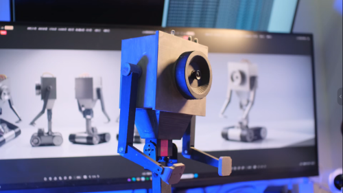
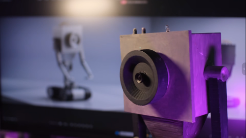
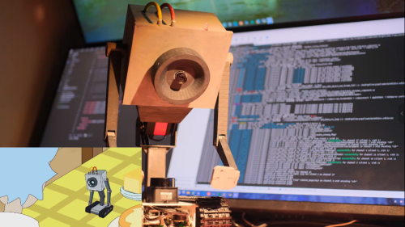
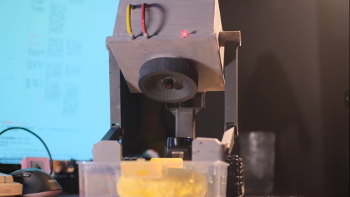
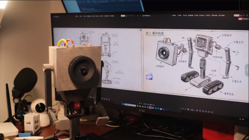
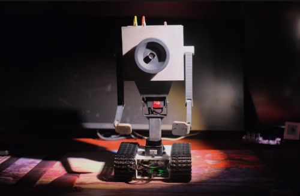
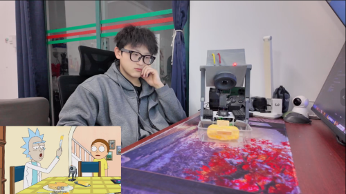
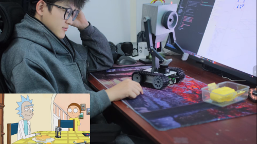
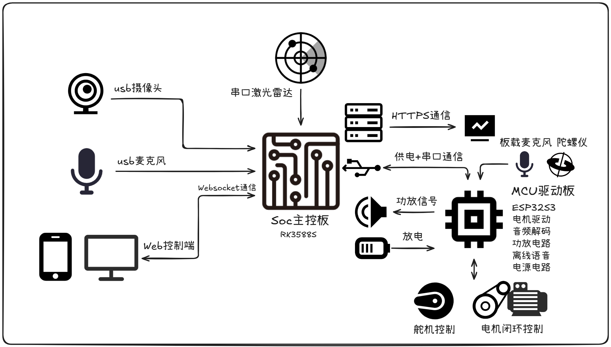

# 黄油机器人项目介绍

复刻与部署方法见[开始前的准备](project_status.md)和[复刻步骤](3_Development_instructions.md)，也可以按需查看各功能章节。

## 📖 项目简介

**黄油机器人（Butter Robot）** 是一款基于 ROS2 Humble 的移动机器人学习与开发平台，采用 Rockchip RK3588S 作为主控芯片，搭配 ESP32S3 微控制器实现底层运动控制。项目涵盖感知、定位建图、运动控制、视觉处理和语音交互五大核心功能模块，是一个集成度较高的机器人学习与开发平台。

## 教程与资源

- [开始前的准备](project_status.md)：确认环境、硬件和设备信息。
- [资源准备](7_Resources.md)：获取程序、测试文件和所需模型。
- [复刻步骤](3_Development_instructions.md)：按顺序配置和运行机器人。

## 📷 产品外观

::::{container} recovered-product-gallery

|                                                                                                  |                                                                                                  |
| :----------------------------------------------------------------------------------------------: | :----------------------------------------------------------------------------------------------: |
|  |  |
|  |  |
|  |  |
|  |  |

::::

## 🏗️ 系统架构

系统采用分层模块化架构，主要分为以下五层：

- **感知层**：集成 LDLiDAR 2D 激光雷达（360° 环境扫描）、1080P 摄像头、6 轴 IMU 惯性测量单元和轮式编码器里程计，提供多源环境感知能力。
- **定位与建图层**：基于 slam_toolbox 实现在线异步 SLAM 建图，通过 robot_localization 扩展卡尔曼滤波（EKF）融合轮式里程计与 IMU 数据，定位配置使用 laser_filters 过滤机器人自身遮挡；当前建图输入仍为原始雷达。
- **控制层**：通过 UART 串口（460800 波特率）与 ESP32S3 通信，实现差速驱动底盘的 PID 速度控制和舵机控制，支持键盘与手柄输入；大模型到运动指令的接口尚未接通。
- **视觉处理层**：利用 RK3588S 的 NPU（6TOPS 算力）硬件加速 YOLOv8 目标检测，三个视觉组件（采集、推理、推流）运行在同一 ComposableNodeContainer 中，启用进程内通信减少节点间图像复制。
- **交互层**：集成 sherpa-onnx ASR 语音识别、RKLLM 本地文本生成和百度大模型音色复刻 TTS 语音合成，实现全流式语音交互；同时通过 Foxglove Bridge 提供 Web 端远程监控与数字孪生可视化。

## 🎬 视频演示

> 📺 **视频作者**：B站 @鸿尘客
> 🔗 **视频链接**：[黄油机器人](https://www.bilibili.com/video/BV1hQcFzrEXS/?spm_id_from=333.1007.top_right_bar_window_history.content.click)

## ⚙️ 硬件规格

以下为本项目使用的硬件配置。采用其他存储或外设时，按实际设备调整配置。

|     项目     |                      参数                      |
| :----------: | :--------------------------------------------: |
|  主芯片 SOC  |                Rockchip RK3588S                |
|     CPU      | 4 核 Cortex-A76(2.4GHz)+4 核 Cortex-A55(1.8GHz) |
|     NPU      |                     6TOPS                      |
|     VPU      |          H.264/H.265/JPEG 硬件编解码           |
|     RAM      |                   LPDDR5 8GB                   |
|      TF      |                      32GB                      |
|  Wi-Fi+蓝牙  |                 Wi-Fi 5+BT 5.0                 |
|  驱动器 MCU  |                    ESP32S3                     |
|   电池容量   |                  3000mAh 12V                   |
| 摄像头分辨率 |                1920x1080 30FPS                 |
|   操作系统   |                  Ubuntu22.04                   |
|   ROS 版本   |                  ROS2 Humble                   |

## 📐 硬件框图

## 🚀 产品功能

> **五大核心能力**：语音交互 | 运动控制 | 视觉处理 | 定位导航 | 远程监控

---

### 🗣️ 语音交互 —— 识别、文本生成与播报

|        模块        | 核心能力                                   | 技术方案                                                         |
| :----------------: | :----------------------------------------- | :--------------------------------------------------------------- |
|  **ASR 语音识别**  | 中英双语实时识别，增量输出无需等待整句     | sherpa-onnx + RKNN 加速 Zipformer，48kHz→16kHz 重采样，端点检测  |
| **LLM 大语言模型** | 本地文本流式生成；可触发拍照，图像理解未接通      | Qwen3-VL-2B 文本推理路径，RKLLM，4096 上下文，流式输出    |
|  **TTS 语音合成**  | 自定义音色克隆，支持多种方言，边合成边播放 | 百度大模型音色复刻 API，句级分段合成，HTTP 流式推送（端口 8090） |

### 🎮 运动控制 —— 多模式操控，精准灵活

|       模块       | 核心能力                                     | 技术方案                                                           |
| :--------------: | :------------------------------------------- | :----------------------------------------------------------------- |
| **差速驱动底盘** | PID 闭环控制；键盘线速度配置 0.15 m/s，在线调参默认关闭  | UART 460800 波特率通信 ESP32S3，自定义二进制协议，左右电机独立控制 |
|   **舵机控制**   | 3 路舵机接口与关节状态映射；固件舵机初始化默认关闭    | `/joint_states` 话题发布关节状态，角度精确控制                     |
|   **键盘遥控**   | WASD 八方向移动，launch 配置 0.2 秒无输入停车        | launch 配置 50 Hz 轮询                                                     |
|   **手柄遥控**   | 摇杆模拟量控制速度，按键控制舵机（±5° 步进） | 线速度 + 角速度双轴控制                                            |
|   **语音控制接口**   | ASR / LLM 文本链路已有；运动指令转换待实现                 | 尚无 LLM 到运动控制的桥接                                               |

### 👁️ 视觉处理 —— NPU 检测与视频推流

|      模块      | 核心能力                                    | 技术方案                                   |
| :------------: | :------------------------------------------ | :----------------------------------------- |
| **摄像头采集** | 1080P@30fps 硬件加速采集，支持 RGA 硬件旋转 | GStreamer + v4l2src，NV12 原生格式输出     |
|  **目标检测**  | 单类别黄油检测与图像标注；手掌检测、跟随未实现                    | YOLOv8 + RKNN NPU 加速，640x640，NMS 0.45  |
|  **视频推流**  | RTSP 实时推流，同进程图像传输优化             | MPP 硬件 H.264 编码，ComposableNode 进程内通信 |

### 🗺️ 定位导航 —— SLAM 建图与 Nav2 配置

|      模块      | 核心能力                                      | 技术方案                                         |
| :------------: | :-------------------------------------------- | :----------------------------------------------- |
| **里程计融合** | 50 Hz 配置的 EKF 融合轮式里程计与 IMU，输出二维位姿 | robot_localization，2D 模式，odom → base_link TF |
| **SLAM 建图**  | 在线异步建图，回环检测，0.05 m/pixel 分辨率   | slam_toolbox + Ceres 求解器，激光量程 12.0 m     |
| **纯定位模式** | 加载已有地图重定位，过滤自身遮挡              | slam_toolbox 定位模式 + laser_filters            |
|  **自主导航**  | Nav2 规划与避障配置；完整任务闭环待集成                       | Nav2 原型，NavFn / DWB；控制与检测接口待集成                  |

### 🖥️ 远程监控 —— Web 端数字孪生，随时随地掌控

|        能力         | 说明                                                           |
| :-----------------: | :------------------------------------------------------------- |
| **Foxglove 可视化** | WebSocket（端口 8765）实时查看机器人状态、话题数据和 TF 坐标树 |
|   **RTSP 视频流**   | 远程查看摄像头画面及目标检测结果                               |
|    **远程控制**     | Web 端发布控制指令，实现数字孪生效果                           |
