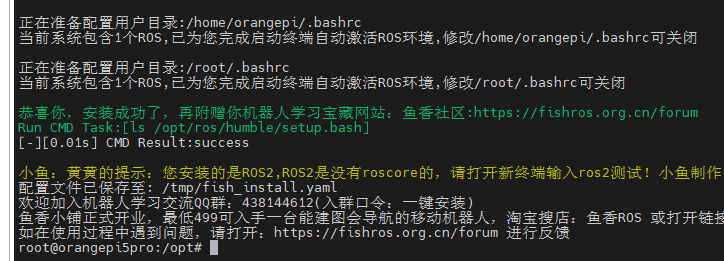
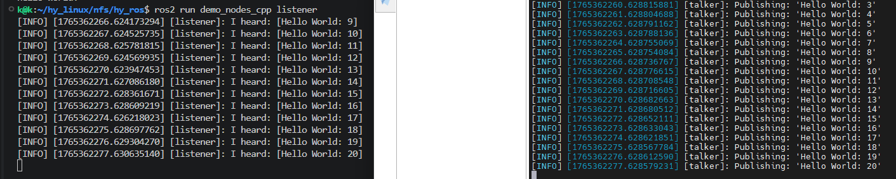

# 端侧环境配置

先完成[主机环境配置](host_setup.md)，准备 TF 卡、板卡电源和网络。本节在 RK3588S 板卡上操作；后续教程统一使用 `/mnt/nfs/hy_ros` 作为端侧工作区。

## 烧录与网络配置

### 烧录镜像文件

烧录镜像文件 **Orangepi5pro_1.0.6_ubuntu_jammy_server_linux5.10.160** 到 tf 卡中。

### 修改 root 用户自动登录终端

密码为 **orangepi**

```shell
sudo auto_login_cli.sh root
```

### 连接 wifi

```{note}
输入自己的 wifi 名和密码，并记录 ip 地址。
```

```shell
sudo nmcli dev wifi connect wifi名称 password wifi密码
ip addr show wlan0
```

### SSH 远程连接测试

密码为 orangepi

```{note}
替换为端侧 ip 地址。例如 192.168.22.188
```

```shell
ssh root@端侧IP地址
```

## 挂载配置

### 挂载 NFS

```{important}
挂载命令中需修改为实际的 ubuntu 主机侧 IP 地址（如 192.168.22.177）、NFS 开发路径（如 /home/k/hy_linux/nfs）和端侧挂载路径（如 /mnt/nfs）。
```

```shell
# 1. 安装和挂载NFS
sudo apt update
sudo apt install -y nfs-common
mkdir -p /mnt/nfs
# 手动挂载，重启后不会自动挂载
# 命令格式：sudo mount -t nfs -o nolock 主机IP地址:/主机共享路径 端侧挂载路径
sudo mount -t nfs -o nolock 192.168.22.177:/home/k/hy_linux/nfs /mnt/nfs

# 2. 配置nfs开机自动挂载
# 2.1 修改环境变量，设置开机自动加载~/.bashrc
echo -e 'if [ -f ~/.bashrc ]; then\n    . ~/.bashrc\nfi' >> ~/.bash_profile

# 2.2 修改环境变量，添加自动挂载nfs命令并激活环境
echo 'sudo mount -t nfs -o nolock 192.168.22.177:/home/k/hy_linux/nfs /mnt/nfs' >> ~/.bashrc
source ~/.bash_profile
```

### 挂载 emmc(可选)

TF 卡已能启动系统时，可以跳过本节。需要使用 eMMC 扩展存储时，先用 `lsblk` 确认目标分区；下面的格式化命令只用于无需保留数据的空闲分区。

```shell
# 挂载emmc作为存储空间并配置开机自动挂载
# 查看所有存储设备和分区，查看是否有未挂载的eMMC分区
lsblk
# 格式化存储空间大的分区格式化为ext4（-F强制格式化，-L添加卷标hy_tmp，方便识别）(按实际情况修改mmcblk0p2)
sudo mkfs.ext4 -F -L hy_tmp /dev/mmcblk0p2
# 创建挂载点目录
sudo mkdir -p /hy_tmp
# 设置目录权限（允许所有用户读写执行，方便存放文件）
sudo chmod 777 /hy_tmp
# 设置目录所有者（可选，让当前用户拥有完整权限）
sudo chown $USER:$USER /hy_tmp
# 查看mmcblk0p2的UUID（复制输出中的UUID值，不含引号）
blkid /dev/mmcblk0p2
# 使用nano编辑器打开fstab（新手推荐nano，操作简单）
sudo nano /etc/fstab
# 添加以下内容到fstab文件末尾(将UUID替换为实际值)
# 写入 /etc/fstab 的内容：UUID=实际UUID /hy_tmp ext4 defaults 0 2
# 查看是否挂载成功
df -h
# 读写测试
# 进入/hy_tmp目录
cd /hy_tmp
# 创建测试文件夹和文件
mkdir video audio screenshot
touch audio/test.mp3 video/test.mp4 screenshot/test.png
# 查看创建结果
ls -l
```

## 安装 ROS2 humble

参考教程：[鱼香 ROS2 一键安装](https://blog.csdn.net/weixin_71683006/article/details/150465016?ops_request_misc=elastic_search_misc&request_id=dd0d7d3fd479c65031b7b2767c112822&biz_id=0&utm_medium=distribute.pc_search_result.none-task-blog-2~all~top_positive~default-1-150465016-null-null.142^v102^pc_search_result_base3&utm_term=%E9%B1%BC%E9%A6%99ros2%E4%B8%80%E9%94%AE%E5%AE%89%E8%A3%85&spm=1018.2226.3001.4187)

```shell
# 一键配置ROS2 humble开发环境
cd /opt
wget --no-check-certificate https://fishros.com/install -O fishros
chmod +x fishros
./fishros
# 1:一键安装 -> 1:更换系统源再继续安装 -> 2:更新系统源并清理第三方源 -> 1：自动测速选择最快的源 -> \
# 1:中科大镜像源 -> 1:humble(ROS2) -> 1:humble(ROS2)桌面版 -> 开始自动安装等待20min左右
```

[](../_static/recovered/ylDjRa.png)

- 可在主机环境按照相同方法同步配置完 ros2 后，测试双端通信是否成功
  - 端侧：`ros2 run demo_nodes_cpp talker`
  - 主机侧：`ros2 run demo_nodes_cpp listener`

[](../_static/recovered/ylDFP4.png)

## 完成后检查

- SSH 能连接板卡，重新登录后网络仍可用。
- `ls /mnt/nfs/hy_ros/src` 能列出功能包，`ls /mnt/nfs/hy_ros/source` 能看到已准备的模型与测试资料。
- 在新终端执行 `source /opt/ros/humble/setup.bash` 后，`ros2 --help` 能显示帮助；两端 talker / listener 通信正常。

后续每个独立终端都先加载 ROS 环境；编译工作区后再执行 `source /mnt/nfs/hy_ros/install/setup.bash`。如果端侧不能写入共享工作区，先检查 NFS 共享目录的写权限。

接着完成[硬件连接与测试](hardware_testing.md)。
