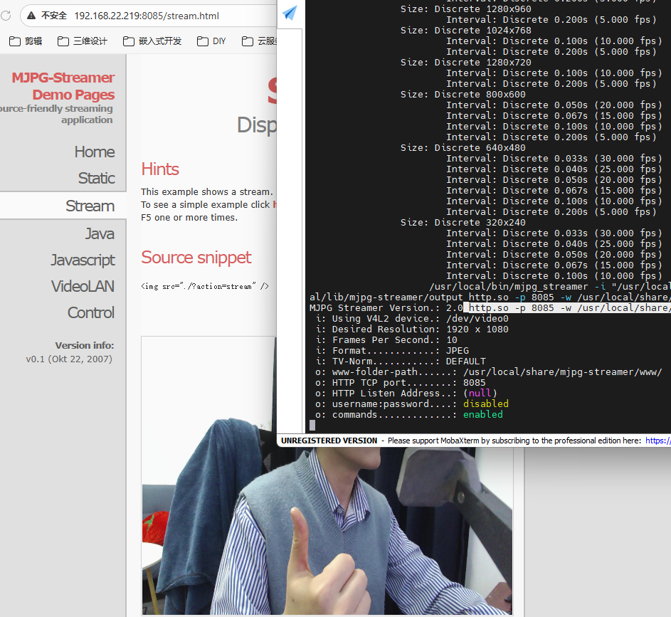
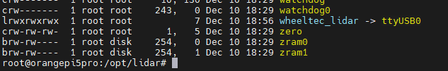
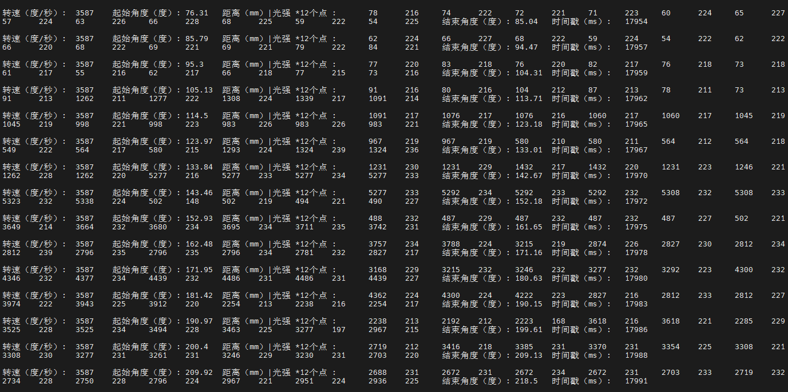

# 硬件连接与测试

在已完成[端侧配置](device_setup.md)的板卡上，依次检查摄像头、雷达、麦克风和串口。先按[资料获取](../7_Resources.md)准备测试脚本与图片；本节暂不启动 ROS 视觉或导航节点。

## 摄像头测试

```shell
# 配置推流环境
mkdir /opt/camera
cd /opt/camera
# 安装cmake和libjpeg8-dev（用于编译mjpg-streamer）
sudo apt-get install cmake libjpeg8-dev
# 下载固定版本的摄像头测试程序
git clone https://github.com/jacksonliam/mjpg-streamer.git
cd mjpg-streamer
git checkout 310b29f4a94c46652b20c4b7b6e5cf24e532af39
cd mjpg-streamer-experimental
make
sudo make install
# 安装v4l工具（用于查询摄像头参数）
sudo apt install -y v4l-utils
# 查看摄像头支持的格式、分辨率、帧率
v4l2-ctl --list-formats-ext
# 启动推流服务
/usr/local/bin/mjpg_streamer -i "/usr/local/lib/mjpg-streamer/input_uvc.so -d /dev/video0 -n -f 10 -r 1920x1080" -o "/usr/local/lib/mjpg-streamer/output_http.so -p 8085 -w /usr/local/share/mjpg-streamer/www"
```

```{tip}
打开浏览器，输入**端侧 IP 地址加端口号**（如：http://192.168.22.188:8085）即可查看实时视频流。
```

[](../_static/recovered/ylDTcN.png)

浏览器应能看到连续变化的摄像头画面。测试结束后按 `Ctrl+C` 停止该服务，再启动后续视觉节点，避免同时占用 `/dev/video0`。

## 雷达测试

```shell
# 新建应用程序空间
mkdir /opt/lidar
cd /opt/lidar
# 上传wheeltec_udev.sh脚本到该目录，上传ldlidar_driver_python3.py文件到该目录
cp /mnt/nfs/hy_ros/source/1.Lidar/wheeltec_udev.sh /opt/lidar/
cp /mnt/nfs/hy_ros/source/1.Lidar/ldlidar_driver_python3.py /opt/lidar/
# 赋予执行权限
sudo chmod 777 wheeltec_udev.sh
sudo chmod 777 ld*
# 执行脚本
sudo ./wheeltec_udev.sh
# 重新插拔后检查更名是否成功（wheeltec_lidar -> ttyUSB0）
ls -l /dev
# 检查python版本，安装pyserial库
sudo apt install -y python3-pip
sudo pip3 install pyserial
# 执行对应测试脚本（输出刷新说明雷达正常工作）
python3 ldlidar_driver_python3.py
```

[](../_static/recovered/ylDU8H.png)

[](../_static/recovered/ylDARQ.png)

终端应持续输出雷达数据。测试结束后按 `Ctrl+C` 停止脚本，再启动 ROS 雷达驱动。这里的测试设备别名为 `wheeltec_lidar`；ROS 雷达驱动使用 `/dev/ldlidar_serial`，按[SLAM 教程](slam.md)配置其 udev 规则。

## 麦克风测试

```shell
# 查看麦克风设备列表
arecord -l
# 测试麦克风录音
mkdir -p /tmp/record
arecord --device=plughw:3,0 --format S16_LE --rate 44100 -c 2 -d 5 /tmp/record/test.wav
# 参数说明：
# --device=plughw:3,0：指定使用的麦克风设备（根据arecord -l输出的设备列表修改）
# --format S16_LE：指定音频格式为16位小端字节序
# --rate 44100：指定采样率为44100Hz
# -c 2：指定通道数为2（立体声）
# -d 5：指定录音时长为5秒
# /tmp/record/test.wav：指定输出文件路径
# 检查并下载test.wav文件是否录音成功
```

将 `/tmp/record/test.wav` 复制到主机播放，应能听到刚才录制的声音。设备号不是 `3,0` 时，先按 `arecord -l` 的结果修改录音命令。

## 串口启动

```shell
# 启动串口3
sudo orangepi-config
# 依次选择System->Hardware -> uart3-m2 -> Space开启 -> save -> back -> Reboot
```

## 完成后检查

- 摄像头能显示实时画面，雷达测试脚本持续输出数据。
- 录音文件有声音，记下实际麦克风设备号，供[语音配置](voice.md)使用。
- 重启后 `ls -l /dev/ttyS3` 能找到底盘串口；该端口是 UART 功能包的默认配置。

硬件检查完成后，继续配置[语音](voice.md)、[可视化](visualization.md)和[视觉检测](vision.md)。
