# 目标检测模型训练与转换

如果使用随资料提供的黄油模型，可以跳过训练，直接进入[视觉检测与视频推流](vision.md)。需要重新训练时，准备一台带 NVIDIA CUDA GPU 的 Windows 主机，并按下文完成数据集、训练和 RKNN 转换；转换阶段在 Ubuntu 主机上操作。

## 数据集准备

1. 使用摄像头自行采集并保存图片到 `source/butter_img`（建议 300 张以上），再按下文标注；也可以直接使用下方 Roboflow 的已标注黄油数据集。

2. 使用 [roboflow](https://app.roboflow.com) 平台实现数据集标注和管理。

```{tip}
可从 [butter_robot_dataset](https://universe.roboflow.com/butter-robot/butter_robot) 获取已标注图片，也可以补充在机器人摄像头下拍摄的样本。保持类别名称为 `butter`，并将图片划分为训练集、验证集和测试集。
```

[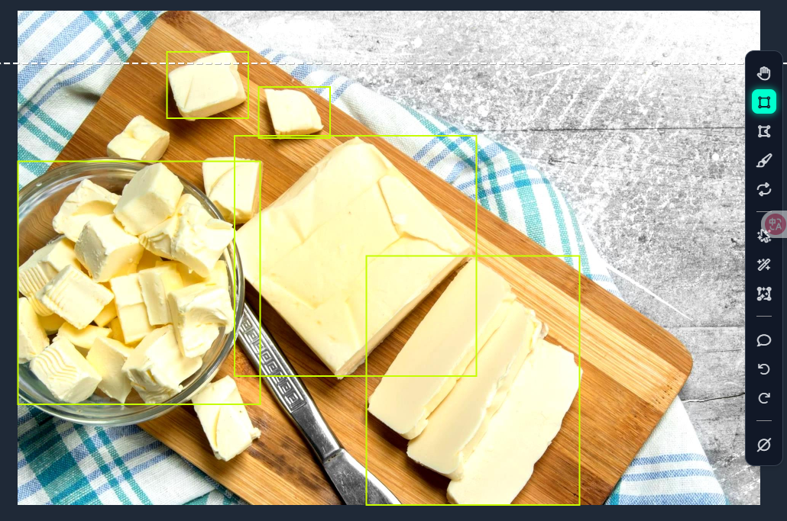](../_static/recovered/ylDQYY.png)

[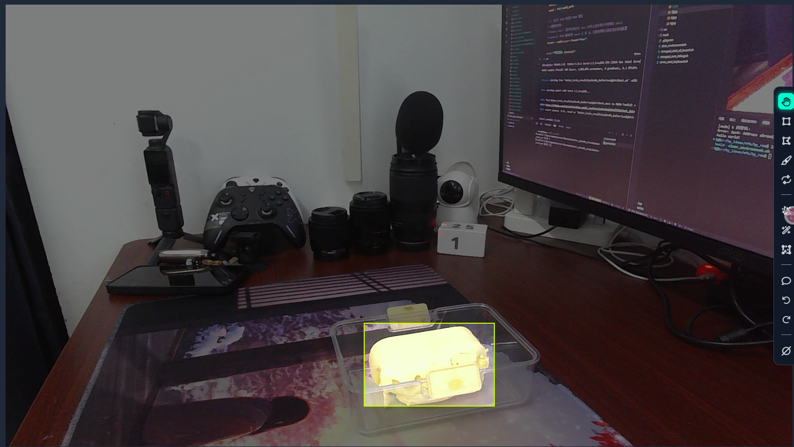](../_static/recovered/ylDW3b.png)

[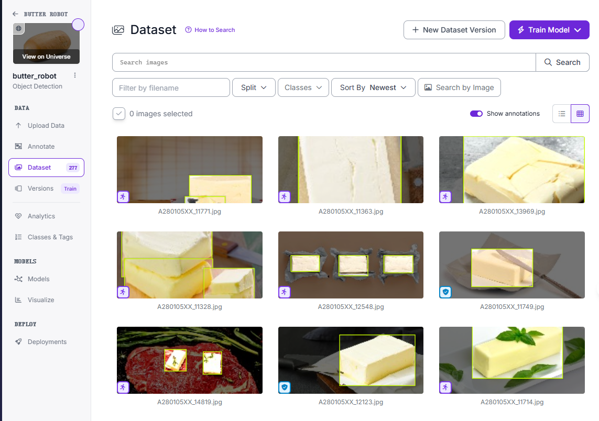](../_static/recovered/ylD2T1.png)

3. 数据集预处理包括数据增强、数据划分，下载 yolov8 数据集配置文件。

[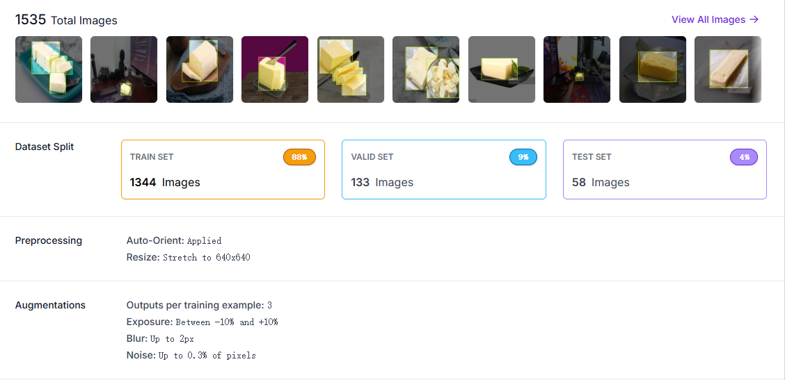](../_static/recovered/ylDJuL.png)

下载版本 3 的 YOLOv8 导出包，解压到 `butter_yolov8n_train/Dataset/`，应包含 `train/`、`valid/`、`test/`。打开 `dataset.yaml`，确认目录路径与解压结果一致；数据集使用条件以 Roboflow 页面为准。

## Win 环境实现模型训练

### 配置虚拟环境

从 `DIY_hyrobot` 根目录进入训练目录，使用配套的 `butter_train_env/pyproject.toml` 和 `uv.lock` 创建环境：

```powershell
cd butter_yolov8n_train
uv sync --project butter_train_env --frozen --python 3.12
uv run --project butter_train_env --frozen python -m ipykernel install --user --name butter_train --display-name "Python (butter_train)"
```

IDE 打开 `butter_yolov8n_train.ipynb`，选择 `Python (butter_train)` 内核。Notebook 的工作目录应为 `butter_yolov8n_train`，以便读取 `dataset.yaml`、`yolov8n.pt` 和训练输出目录。训练在 Notebook 中执行。

### CUDA 与锁定依赖

训练环境使用 Python 3.12、PyTorch 2.5.1、torchvision 0.20.1、torchaudio 2.5.1，以及 CUDA 12.4 wheel。安装支持该版本的 NVIDIA 驱动后，运行下面的检查；`torch.cuda.is_available()` 应输出 `True`，Notebook 使用第一块 GPU（`cuda:0`）。

```powershell
uv run --project butter_train_env --frozen python -c "import torch; print(torch.__version__, torch.version.cuda, torch.cuda.is_available())"
```

### 安装 ultralytics

使用 airockchip 修改版 Ultralytics 8.2.82，固定提交为 `4674fe6e003dfbc5f2250d3b39dd31faaf7a9877`。上述 `uv sync --frozen` 会安装该版本；保持此版本以使用下面的 RKNN 导出流程。

```{important}
此版本的 `format="rknn"` 先导出 RKNN 兼容 ONNX（opset 12），随后还需使用 RKNN-Toolkit2 转为 `.rknn`。导出接口说明见[Ultralytics RKNN 导出实现](https://github.com/airockchip/ultralytics_yolov8/blob/4674fe6e003dfbc5f2250d3b39dd31faaf7a9877/ultralytics/engine/exporter.py)。
```

```python
# 测试安装是否全部成功
import torch
import ultralytics
from ultralytics import YOLO
from pathlib import Path

# 验证PyTorch GPU可用性
print("PyTorch GPU可用：", torch.cuda.is_available())
print("PyTorch版本：", torch.__version__)
print("CUDA wheel版本：", torch.version.cuda)
# 验证Ultralytics版本及GPU适配
print("Ultralytics版本：", ultralytics.__version__)
# 加载YOLOv8n并指定GPU
model = YOLO("yolov8n.pt")
model.to("cuda:0")
print("YOLOv8n已加载到GPU：", next(model.model.parameters()).is_cuda)
```

[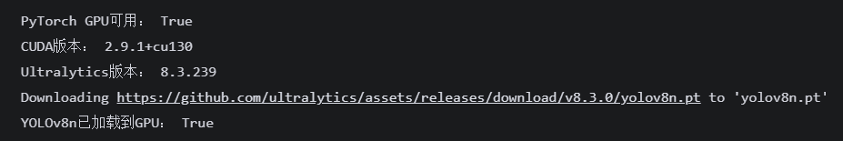](../_static/recovered/ylD4eM.png)

### yolov8n 模型训练和转换

```python
# 开始训练
# data: 数据集配置文件路径 (使用绝对路径避免错误)
# epochs: 训练轮数
# imgsz: 输入图像大小
# batch: 批次大小
# device: 训练设备 (0 表示使用第一块 GPU)
results = model.train(
    data=str(Path("dataset.yaml").resolve()),
    epochs=120,
    imgsz=640,
    batch=64,
    device=0,
    project="butter_train_results",
    name="yolov8n_butter",
    exist_ok=True,  # 允许覆盖同名目录，方便调试
    verbose=True,  # 显示详细训练日志
)
```

```shell
# 启动 tensorboard 可视化训练过程
uv run --project butter_train_env --frozen tensorboard --logdir butter_train_results/yolov8n_butter --port 6006
```

训练完成后，检查 `butter_train_results/yolov8n_butter/results.csv` 和 `weights/best.pt`。下面给出一组 120 轮训练的结果示例，供理解指标；自己的数值以该次训练输出为准。批次默认 64，显存不足时减小批次再运行。

|        数据类别         | 指标 / 损失名称 | 最终数值 | 单位 | 备注                          |
| :---------------------: | :-------------: | :------: | :--: | :---------------------------- |
|  **Metrics 检测指标**   |    mAP50(B)     |  92.56%  |  -   | IoU≥0.5 时的平均精度          |
|                         |   mAP50-95(B)   |  75.70%  |  -   | IoU 从 0.5 到 0.95 的平均精度 |
|                         |  Precision(B)   |  89.25%  |  -   | 预测为黄油的精准度            |
|                         |    Recall(B)    |  87.58%  |  -   | 实际黄油的召回率              |
| **训练集（Train）损失** |    box_loss     |  0.2732  |  -   | 预测框位置损失                |
|                         |    cls_loss     |  0.1944  |  -   | 黄油类别预测损失              |
|                         |    dfl_loss     |  0.83165 |  -   | 框分布拟合损失                |
|  **验证集（Val）损失**  |    box_loss     |  0.7615  |  -   | 预测框位置损失                |
|                         |    cls_loss     |  0.7156  |  -   | 黄油类别预测损失              |
|                         |    dfl_loss     |  1.3528  |  -   | 框分布拟合损失                |

[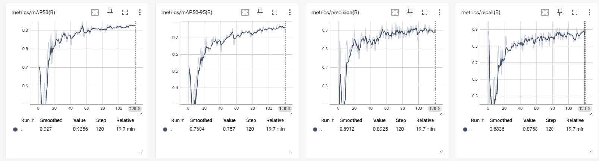](../_static/recovered/ylDEKr.png)

[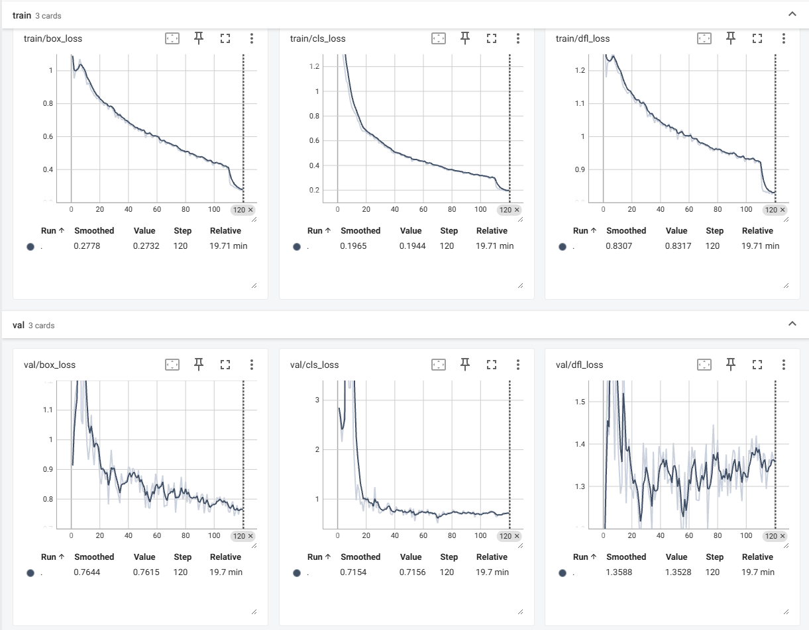](../_static/recovered/ylDlyh.png)

```python
from ultralytics import YOLO
from pathlib import Path
# 1. 加载训练好的最佳权重文件
model_path = "butter_train_results/yolov8n_butter/weights/best.pt"
model = YOLO(model_path)
# 2. 导出为 RKNN 兼容的 ONNX 模型
# 关键参数说明：
# format='rknn': 指定导出格式为 rknn (实际上会先导出为特殊的 onnx)
success = model.export(format="rknn")
print(f"导出完成: {success}")
```

```{warning}
必须使用 ultralytics rknn 修改版才能正确导出 RKNN 模型，导出的 `best.onnx` 位于权重同目录，之后需转换为 `.rknn`。
```

[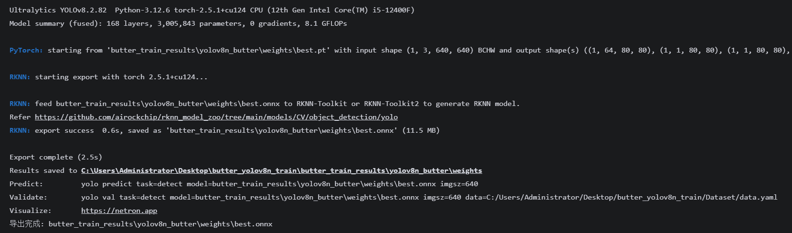](../_static/recovered/ylDtge.png)

## Ubuntu 环境实现模型转换

### docker 安装 RKNN-Toolkit2

因为在宿主机配置 RKNN-Toolkit2 环境极易出错，所以建议在 Ubuntu 环境下使用 Docker 容器来运行 RKNN-Toolkit2。

1. 下载并安装 Docker

```shell
# 1. 安装Docker并配置自启
sudo apt update -y

# 安装apt依赖工具（允许HTTPS访问仓库、解压缩等）
sudo apt install -y ca-certificates curl gnupg lsb-release git

# 创建密钥存储目录
sudo mkdir -p /etc/apt/trusted.gpg.d

# 下载并添加Docker官方GPG密钥（使用阿里云镜像修复SSL连接问题）
curl -fsSL https://mirrors.aliyun.com/docker-ce/linux/ubuntu/gpg | sudo gpg --dearmor -o /etc/apt/trusted.gpg.d/docker.gpg

# 配置Docker仓库源（使用阿里云镜像加速）
echo \
  "deb [arch=$(dpkg --print-architecture) signed-by=/etc/apt/trusted.gpg.d/docker.gpg] https://mirrors.aliyun.com/docker-ce/linux/ubuntu \
  $(lsb_release -cs) stable" | sudo tee /etc/apt/sources.list.d/docker.list > /dev/null

# 更新软件包索引
sudo apt update

# 安装Docker核心组件（engine+cli+containerd）
sudo apt install -y docker-ce docker-ce-cli containerd.io

# 启动Docker服务（若未自动启动）
sudo systemctl start docker

# 设置Docker开机自启
sudo systemctl enable docker

# 配置 Docker 镜像加速（解决拉取镜像失败/速度慢的问题）
sudo mkdir -p /etc/docker
sudo tee /etc/docker/daemon.json <<-'EOF'
{
  "registry-mirrors": [
    "https://docker.m.daocloud.io",
    "https://huecker.io"
  ]
}
EOF
sudo systemctl daemon-reload
sudo systemctl restart docker

# 验证Docker是否正常运行（输出"Hello from Docker!"即成功）
sudo docker run --rm hello-world

# 将当前用户添加到docker组
sudo usermod -aG docker $USER

# 刷新组权限（无需重启，立即生效）
newgrp docker

# 验证：无需sudo执行docker命令
docker ps
```

[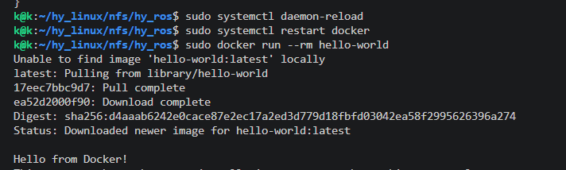](../_static/recovered/ylDKoa.png)

2. 下载 rknn-toolkit2 的 Dockerfile

```shell
# 1. 下载 rknn-toolkit2 的 Dockerfile
# 创建目录并进入
sudo mkdir -p /opt/rknn-toolkit2/tools-file
cd /opt/rknn-toolkit2/tools-file

# 克隆仓库（使用 Gitee 镜像加速下载）
sudo git clone https://gitee.com/cddssgl/rknn-toolkit2.git
cd rknn-toolkit2/rknn-toolkit2/docker/docker_file/ubuntu_20_04_cp38

# 2. 修改 Dockerfile 源（解决 pip 安装依赖失败问题）
sudo sed -i 's|mirror.baidu.com|mirrors.aliyun.com|g' Dockerfile_ubuntu_20_04_for_cp38

# 3. 构建镜像
sudo docker build -f Dockerfile_ubuntu_20_04_for_cp38 -t rknn-toolkit2:cp38-2.3.2 .

# 4. 验证镜像是否构建成功
sudo docker image inspect rknn-toolkit2:cp38-2.3.2
```

[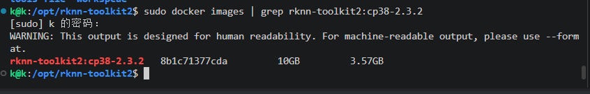](../_static/recovered/ylDGWC.png)

3. 挂载启动 docker 容器

```shell
# 1.先创建本地工作目录
sudo mkdir -p /opt/rknn-toolkit2/workspace
cd /opt/rknn-toolkit2/workspace

# 2.启动命令（挂载本地目录+映射 8888 端口）
sudo docker run -it --privileged \
  -v /opt/rknn-toolkit2/workspace:/root/workspace \
  -p 8888:8888 \
  --name rknn-cp38-container \
  rknn-toolkit2:cp38-2.3.2 /bin/bash

# 3.进入容器后执行以下命令
python3 --version
python3 -c "from rknn.api import RKNN; from importlib.metadata import version; print(version('rknn-toolkit2'))"
```

[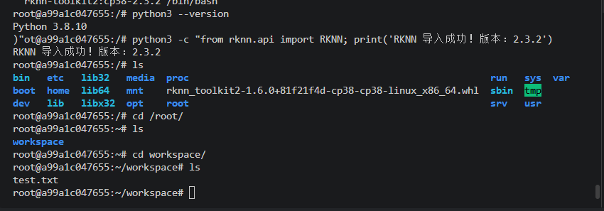](../_static/recovered/ylDmu4.png)

4. 常用容器管理命令（在 Ubuntu 宿主机另一终端执行，不是在容器中）

```shell
# 1. 列出运行中的容器
docker ps

# 2. 停止容器（替换为容器名称/ID）
docker stop rknn-cp38-container

# 3. 重新启动已停止的容器
docker start rknn-cp38-container

# 4. 进入已运行的容器（再次打开终端）
docker exec -it rknn-cp38-container /bin/bash

# 5. 删除镜像（无需使用时清理磁盘空间）
docker rmi rknn-toolkit2:cp38-2.3.2
```

### 转换模型

```{note}
此时环境为 Ubuntu 主机环境，容器只是用于执行转换脚本，所有模型文件挂载在主机目录下 `/opt/rknn-toolkit2/workspace` 中。
```

```shell
# 1. 克隆 rknn_model_zoo 仓库，使用脚本文件转换模型
cd /opt/rknn-toolkit2/workspace
sudo git clone https://gitee.com/airockchip/rknn_model_zoo.git

cd rknn_model_zoo/examples/yolov8/python

# 2. 上传模型文件和黄油图片到ubuntu目录
# 将 Windows 训练产物 best.onnx 上传到此目录后，再进入容器。
# 文件来源：butter_train_results/yolov8n_butter/weights/best.onnx
ls -l best.onnx
```

```{note}
下面环境为 rknn-toolkit2:cp38-2.3.2 容器内，需要在容器内执行转换脚本。
```

```shell
cd /root/workspace/rknn_model_zoo/examples/yolov8/python
# pip uninstall onnx  # (可选)：可能会因为onnx版本过高导致转换失败
# pip install "onnx==1.14.1" # (可选)
# fp 为非量化转换，显式设置产物路径；i8 量化需另行准备实际校准样本
python convert.py best.onnx rk3588 fp ../model/yolov8.rknn
ls -l ../model/yolov8.rknn
```

转换接口见[官方 convert.py](https://github.com/airockchip/rknn_model_zoo/blob/main/examples/yolov8/python/convert.py)。输出文件在容器的 `/root/workspace` 挂载目录内，主机对应路径为 `/opt/rknn-toolkit2/workspace/rknn_model_zoo/examples/yolov8/model/yolov8.rknn`。将该文件复制到板卡的 `/opt/rknn-toolkit2-lite/yolov8.rknn`；若选择配套预训练模型，则使用下面的资料复制命令。

[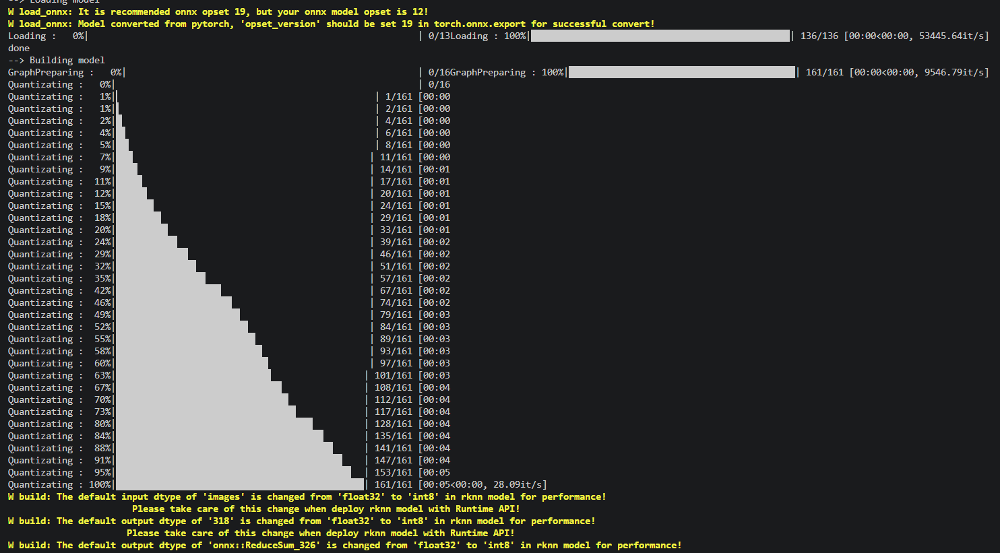](../_static/recovered/ylDXKH.png)

[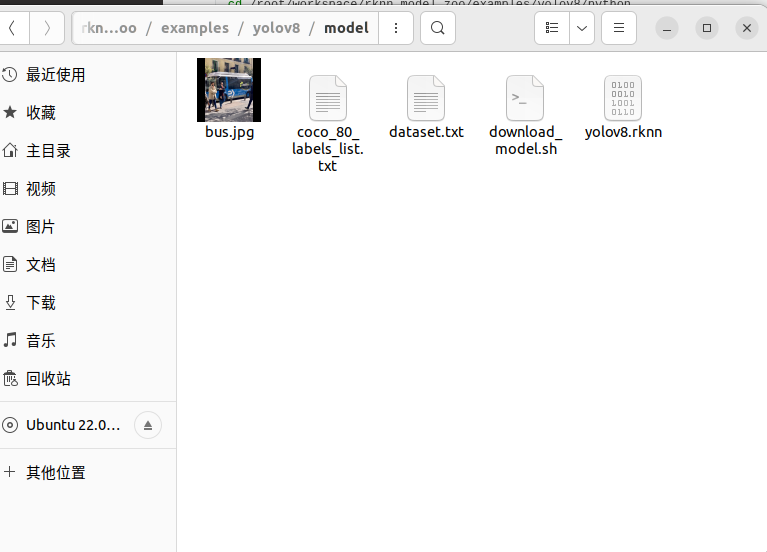](../_static/recovered/ylD3gX.png)

## 端侧测试

```{note}
下面环境为端侧环境，使用 RKNN-Toolkit-Lite2 python 接口测试模型。
```

```shell
# 1. 安装 RKNN-Toolkit-Lite2 python 包
pip3 install rknn-toolkit-lite2

# 2. 测试是否安装成功
python3 -c "from rknnlite.api import RKNNLite; from importlib.metadata import version; print(version('rknn-toolkit-lite2'))"

# 3. 上传模型文件和测试图片到端侧目录
mkdir -p /opt/rknn-toolkit2-lite
cd /opt/rknn-toolkit2-lite

cp /mnt/nfs/hy_ros/source/0.RK3588S/3.butter_yolov8n/yolov8.rknn /opt/rknn-toolkit2-lite/
cp /mnt/nfs/hy_ros/source/0.RK3588S/3.butter_yolov8n/butter.jpg /opt/rknn-toolkit2-lite/
cp /mnt/nfs/hy_ros/source/0.RK3588S/3.butter_yolov8n/test.py /opt/rknn-toolkit2-lite/

# 4. 运行测试脚本
python3 test.py
```

[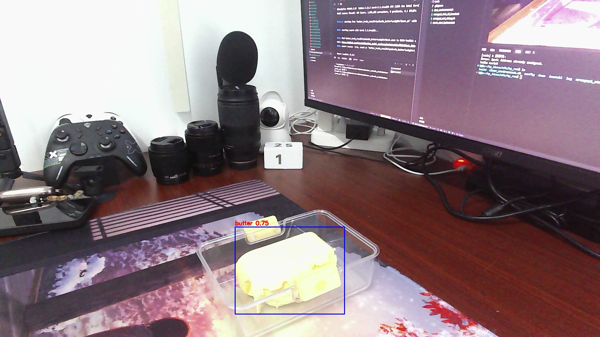](../_static/recovered/ylDiNF.jpg)

## 完成后检查

- 训练目录生成 `weights/best.pt`，导出后同目录存在 `best.onnx`。
- 转换脚本正常退出，指定输出位置存在非空的 `yolov8.rknn`。
- 板卡运行 `test.py` 能加载模型并给出测试图片的检测结果。

将选定的模型放到 `/opt/rknn-toolkit2-lite/yolov8.rknn` 后，继续[视觉检测与视频推流](vision.md)。
