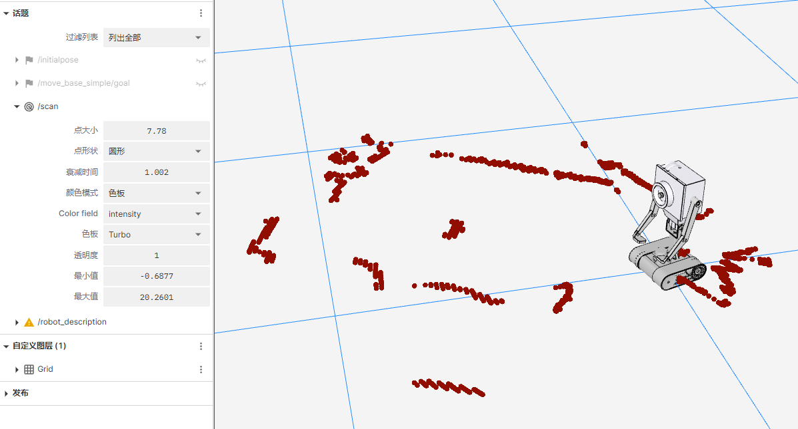

# SLAM 建图与定位

先完成[硬件测试](hardware_testing.md)和[可视化配置](visualization.md)。本节先启动底盘、里程计与雷达，再完成在线建图、保存地图和定位。建图使用原始雷达话题 `/scan`；定位与 Nav2 使用滤波后的 `/scan_filtered`。

## 安装依赖

在端侧（RK3588S）执行以下命令安装必要功能包：

```bash
sudo apt update
sudo apt install -y ros-humble-slam-toolbox ros-humble-navigation2 \
    ros-humble-nav2-bringup ros-humble-laser-filters \
    ros-humble-robot-localization
```

## 配置功能包

以下片段用于解释已有配置的关键字段，不要覆盖完整 YAML。当前建图使用原始雷达，定位使用滤波雷达；切换输入时需要同时核对启动文件和 `scan_topic`。

### 雷达数据裁剪 (Laser Filters)

为解决机器人后方遮挡问题（例如自身结构遮挡），需配置 `laser_filters` 对雷达数据进行裁剪。
打开 `src/hy_slam/config/laser_filter.yaml`，确认以下默认滤波范围；仅在机器人结构或雷达安装位置改变时调整：

```yaml
laser_filter:
  ros__parameters:
    filter1:
      name: rear_box_filter
      type: laser_filters/LaserScanBoxFilter
      params:
        box_frame: base_link
        max_x: 0.029032
        min_x: -0.970968
        max_y: 0.015
        min_y: -0.015
        max_z: 1.0
        min_z: -1.0
        invert: false
```

### SLAM 配置 (Slam Toolbox)

配置 `slam_toolbox` 进行在线建图与地图发布。`slam_toolbox` 在 mapping 模式下会自动发布 `map` -> `odom` 的 TF 变换。
打开 `src/hy_slam/config/mapper_params_online_async.yaml`，确认建图配置：

```yaml
slam_toolbox:
  ros__parameters:
    odom_frame: odom
    map_frame: map
    base_frame: base_link
    scan_topic: /scan # 当前建图使用原始雷达话题；切换滤波输入需同步配置
    mode: mapping

    # 其余参数保留配置文件中的默认值。
    use_scan_matching: true
    map_update_interval: 1.0
    resolution: 0.05
```

### 定位参数配置 (Slam Toolbox)

配置 `slam_toolbox` 进行定位。`slam_toolbox` 在 localization 模式下会根据静态地图与实时雷达数据进行匹配，发布 `map` -> `odom` 的 TF 变换。
打开 `src/hy_slam/config/mapper_params_localization.yaml`，确认定位配置：

```yaml
slam_toolbox:
  ros__parameters:
    odom_frame: odom
    map_frame: map
    base_frame: base_link
    scan_topic: /scan_filtered
    mode: localization

    # 其余参数保留配置文件中的默认值。
    use_scan_matching: true
    map_update_interval: 5.0
    resolution: 0.05
```

## SLAM 在线建图/存图

- `slam.launch.py` 启动 SLAM 建图功能，实现在线建图。调用 `save_map.sh` 脚本保存地图。
- `localization.launch.py` 启动雷达数据裁剪+定位功能，需要已序列化的 pose graph 与实时雷达数据进行匹配，发布 `map` -> `odom` 的 TF 变换。
- `laser_filter_only.launch.py` 仅将 `/scan` 裁剪为 `/scan_filtered`，自身不发布 `map` → `odom`；导航时该变换由 AMCL 发布。

1. 启动雷达功能包

```bash
cd /mnt/nfs/hy_ros
source /opt/ros/humble/setup.bash

# 注意：若未配置udev规则，请先执行，然后重新插拔雷达
sudo bash src/ldlidar_driver_ros2/scripts/Ldlidar_udev.sh

# 1. 编译
colcon build --packages-select ldlidar_driver_ros2

# 2. 运行雷达
source /opt/ros/humble/setup.bash
source install/setup.bash
ros2 launch ldlidar_driver_ros2 ldlidar_driver.launch.py
```

2. 在独立终端启动底盘、EKF 和 URDF，提供里程计与 `base_link` → `radar_Link` 的 TF。先编译相关包并加载工作区：

```bash
cd /mnt/nfs/hy_ros
source /opt/ros/humble/setup.bash
colcon build --packages-up-to uart ekf_odom butter_robot_description hy_slam
source install/setup.bash
ros2 launch uart uart.launch.py
ros2 launch ekf_odom ekf_odom.launch.py
ros2 launch butter_robot_description butter_robot_description.launch.py
```

三个 launch 命令分别在独立终端执行，先核对对应串口和 TF。然后启动 SLAM 建图功能：

```bash
# 编译
cd /mnt/nfs/hy_ros
colcon build --packages-select hy_slam

# 运行
source install/setup.bash
ros2 launch hy_slam slam.launch.py
```

3. 保存地图

```{warning}
请在 `slam.launch.py` 仍在运行时执行保存脚本。若先终止 SLAM 程序，内存中的地图数据将丢失，导致无法保存。
```

完成建图后，打开一个新的终端执行以下脚本：

```bash
# 默认保存为 my_map
cd /mnt/nfs/hy_ros
source /opt/ros/humble/setup.bash
source install/setup.bash
bash src/hy_slam/scripts/save_map.sh

# 或指定地图名
# bash src/hy_slam/scripts/save_map.sh room_1
```

地图保存到 `src/hy_slam/map/`，包含 `.pgm` 和 `.yaml`。用于 Nav2 时，还需按[导航章节](navigation.md)复制到地图加载目录；编译不会代替这一步。

若要使用 slam_toolbox 定位，还需在建图节点运行时保存序列化地图（仅 PGM/YAML 不够）：

```bash
cd /mnt/nfs/hy_ros
source install/setup.bash
ros2 service call /slam_toolbox/serialize_map slam_toolbox/srv/SerializePoseGraph "{filename: '$PWD/src/hy_slam/map/my_map'}"
ls -l src/hy_slam/map/
```

确认服务成功并生成 `.posegraph` 与 `.data` 文件，再停止建图节点。序列化定位要求见[slam_toolbox Humble 官方说明](https://github.com/SteveMacenski/slam_toolbox/blob/humble/README.md#localization)。

## 可视化调试 (Foxglove)

先按[Foxglove 可视化](visualization.md)启动桥接。

使用 Foxglove Studio 查看实时建图效果。

1. **客户端连接**：
   - 在 PC 上打开 Foxglove Studio。
   - 选择 **Open Connection** -> **Foxglove WebSocket**。
   - 地址输入：`ws://<机器人IP>:8765`。

2. **配置面板**：
   - 添加 **2D Panel**。
   - 在左侧 Topics 勾选：
     - `/map` (SLAM 地图)
     - `/scan` (原始雷达)
     - `/scan_filtered` (裁剪后雷达，仅在已启动滤波器时存在；当前建图组没有启动该滤波器)
     - TF 树 (确保 `map` -> `odom` -> `base_link` -> `radar_Link` 连通)。

下面展示 `/scan` 雷达数据的可视化。建图后另选 `/map`，观察地图是否随机器人移动逐步覆盖周围环境。

[](../_static/recovered/ylMzsx.png)

## 定位模式

定位前停止建图节点，避免两个节点同时发布 `map` → `odom`。若已构建地图，可切换至纯定位模式运行（不再更新地图，仅进行定位）：

1. **方式一：使用 slam_toolbox 进行定位**

   该模式下，`slam_toolbox` 加载上面保存的序列化地图（`.posegraph` 与 `.data`），并将实时雷达数据与地图匹配，发布 `map` -> `odom` 变换。

   ```bash
   # 指定序列化地图的绝对路径，不带扩展名
   cd /mnt/nfs/hy_ros
   ros2 launch hy_slam localization.launch.py map_file_name:="$PWD/src/hy_slam/map/my_map"
   ```

2. **方式二：使用 Nav2 (AMCL) 进行定位**（推荐用于导航）

   若后续使用 Nav2 导航栈，通常由 `amcl` 节点负责定位，`map_server` 负责发布地图。此时 `hy_slam` 仅需提供雷达数据裁剪。

   - **步骤 1**：启动雷达滤波器（仅发布 /scan_filtered）

     ```bash
     ros2 launch hy_slam laser_filter_only.launch.py
     ```

   - **步骤 2**：启动 Nav2 (AMCL + Map Server)

     _(需在 Nav2 启动文件中配置加载 `install/hy_slam/share/hy_slam/map/my_map.yaml`)_

```{important}
无论哪种方式，定位模式下**必须**发布雷达数据 (`/scan_filtered`)。
```

## 完成后检查

- 雷达持续发布 `/scan`，`map` → `odom` → `base_link` → `radar_Link` 的 TF 链连通。
- Foxglove 能显示 `/map`；移动机器人后，地图逐步覆盖已经过的区域。
- 保存服务返回成功，`src/hy_slam/map/` 中存在对应的 `.yaml` 和 `.pgm`；使用 slam_toolbox 定位时，还要有同名的 `.posegraph` 和 `.data`。
- 启动定位后保留一个 `map` → `odom` 发布端，不同时运行建图、slam_toolbox 定位和 AMCL。

准备好地图后，继续[Nav2 导航配置](navigation.md)。
