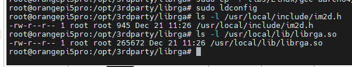
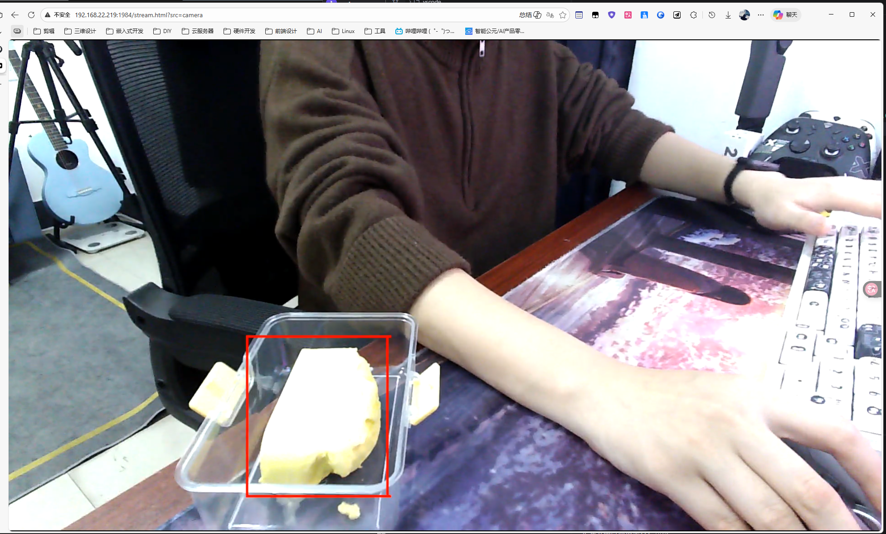

# 视觉检测与视频推流

先完成[摄像头测试](hardware_testing.md)，停止测试推流程序，准备 `/opt/rknn-toolkit2-lite/yolov8.rknn` 模型。本节在板卡安装多媒体依赖，依次启动采集、检测与推流；可使用[配套模型](../7_Resources.md)，也可使用[自行训练转换的模型](model_training.md)。

## 基本原理

视觉管道为 **rk_camera → rk_inference → rk_streamer**，使用 RGA 处理图像、RKNN NPU 推理和 MPP 编码。同进程容器启用 `use_intra_process_comms` 以减少 ROS 节点间图像复制，采集与推流仍需拷贝缓冲区。

当前模型仅检测 `butter`，输出为标注图像；没有手掌检测、自主跟随或 `/detections` 结构化目标发布接口。

**节点 1: rk_camera (采集)**

| **流程描述**       | **关键代码 / 工具**          | **触发的硬件** | **硬件功能**                                                                                                                                        |
| ------------------ | ---------------------------- | -------------- | --------------------------------------------------------------------------------------------------------------------------------------------------- |
| **GStreamer 抓取** | v4l2src (GStreamer 插件)     | **ISP**        | 摄像头传感器进来的数据是 Raw 格式，具体 ISP 与驱动处理由摄像头类型决定；当前 GStreamer 管道接收 NV12 图像。                                                     |
| **数据传输**       | 内核驱动层 (V4L2 Driver)     | **DMA**        | **DMA** 硬件悄悄地把 ISP 处理好的数据搬运到内存（RAM）中，CPU 仍参与软件调度。                                                                          |
| **拷贝到 ROS msg** | memcpy (C++ 标准库)          | **CPU**        | CPU 把 GStreamer 的 Buffer 里的数据拷贝到 ROS 消息的 std::vector 中。（注：这是为了生成 ROS 消息，后续传输才是零拷贝）。 |
| **发布消息**       | pub->publish(std::move(msg)) | **(无)**       | 这是一个软件行为。std::move 转移了指针所有权，**避免了** CPU 进行节点间的数据拷贝。                                                                 |

**节点 2: rk_inference (推理与绘图 -- 核心)**

| **流程描述**        | **关键代码 / 工具**                              | **触发的硬件** | **硬件在做什么？**                                                                                                                           |
| ------------------- | ------------------------------------------------ | -------------- | -------------------------------------------------------------------------------------------------------------------------------------------- |
| **准备 Buffer**     | wrapbuffer_virtualaddr(...)                      | **(无)**       | 纯软件动作。只是告诉 RGA 驱动："数据在这个内存地址，你记一下"。                                                                              |
| **缩放 + 格式转换** | **imresize(src, dst)** 或 imcvtcolor (librga 库) | **RGA**        |  这行代码向 RGA 寄存器发送指令。**RGA 硬件**启动，瞬间把 1080P NV12 读入，处理成 640x640 RGB，写回内存。CPU 等待或做别的事。 |
| **NPU 推理**        | **rknn_run(ctx, ...)** (rknn_api 库)             | **NPU**        |  这行代码唤醒 **NPU 硬件**。NPU 加载模型权重，执行已加载的 RKNN 模型推理。                                        |
| **后处理**          | if (conf > 0.5) ... (C++ 逻辑)                   | **CPU**        | 解析 NPU 输出的浮点数，计算坐标 (x,y,w,h)。这是简单的逻辑判断，CPU 做这个很快。                                                              |
| **RGA 绘图**        | **imrectangle(src, rect, ...)** (librga 库)       | **RGA**        |  代码告诉 **RGA 硬件**："在 src 这个 NV12 图片的 (x,y) 位置，把像素值改成红色"。RGA 直接修改内存，不用 CPU 逐个像素去画。    |
| **发布**            | pub->publish(std::move(msg))                     | **(无)**       | 指针传递，零拷贝。                                                                                                                           |

**节点 3: rk_streamer (推流)**

| **流程描述** | **关键代码 / 工具**                    | **触发的硬件**   | **硬件在做什么？**                                                                                                                                      |
| ------------ | -------------------------------------- | ---------------- | ------------------------------------------------------------------------------------------------------------------------------------------------------- |
| **写入管道** | GstBuffer + memcpy + gst_app_src_push_buffer | **CPU/DMA**      | ROS 图像复制到 GStreamer 缓冲区后写入 appsrc。                                                                                                                         |
| **硬件编码** | Pipeline 字符串中的 **mpph264enc**     | **VPU (RKVENC)** |  mpph264enc 插件调用 MPP 库，MPP 库驱动 **VPU 硬件**。VPU 读取 NV12 原始数据，根据 H.264 算法进行帧内预测、运动估计，输出压缩后的码流。 |
| **网络发送** | rtspclientsink                         | **CPU/网卡**     | CPU 将压缩好的小数据包通过网络协议栈发给网卡。                                                                                                          |

## 端侧依赖安装

在 RK3588S 端侧（Ubuntu 系统）上，需要安装以下基础库：

### 安装 GStreamer 和 rga

```bash
# 1. 安装 GStreamer 及其插件（包含 app 库）
sudo sed -i 's/mirrors.tuna.tsinghua.edu.cn/mirrors.ustc.edu.cn/g' /etc/apt/sources.list
sudo apt-get update

# 编译安装 Rockchip 多媒体组件
sudo apt-get install -y --fix-missing gcc g++ cmake meson ninja-build \
    libdrm-dev libgstreamer1.0-dev libgstreamer-plugins-base1.0-dev \
    gstreamer1.0-plugins-base gstreamer1.0-plugins-good \
    gstreamer1.0-plugins-bad gstreamer1.0-plugins-ugly \
    gstreamer1.0-tools gstreamer1.0-rtsp

# 2. 创建工作目录
sudo mkdir -p /opt/rk_multimedia
sudo chown $USER:$USER /opt/rk_multimedia
cd /opt/rk_multimedia

# 3. 编译安装 MPP (Media Process Platform)
git clone https://github.com/rockchip-linux/mpp.git --depth=1
cd mpp
cd build
cmake -DCMAKE_INSTALL_PREFIX=/usr -DCMAKE_BUILD_TYPE=Release ..
make -j$(nproc)
sudo make install
sudo ldconfig
cd ../..

# 4. 安装 librga (使用预编译库)
git clone https://gitee.com/airockchip/librga.git --depth=1
cd librga
sudo cp -r include/* /usr/local/include/
sudo cp -r libs/Linux/gcc-aarch64/* /usr/local/lib/

# 手动创建 pkgconfig 文件
sudo mkdir -p /usr/local/lib/pkgconfig
sudo tee /usr/local/lib/pkgconfig/librga.pc > /dev/null <<EOF
prefix=/usr/local
exec_prefix=\${prefix}
libdir=\${exec_prefix}/lib
includedir=\${prefix}/include

Name: librga
Description: Rockchip RGA 2D graphics acceleration library
Version: 1.10.0
Libs: -L\${libdir} -lrga
Cflags: -I\${includedir}
EOF

sudo ldconfig
cd ..

# 5. 编译安装 gstreamer-rockchip 插件
git clone https://gitee.com/emancipator/gstreamer-rockchip.git gstreamer-rockchip
cd gstreamer-rockchip
export PKG_CONFIG_PATH=/usr/local/lib/pkgconfig:$PKG_CONFIG_PATH
meson setup build --prefix=/usr --buildtype=release
ninja -C build
sudo ninja -C build install

# 6. 更新库缓存并验证
gst-inspect-1.0 | grep mpp
```

### 安装 RTSP 推流服务器

```bash
# 1. 安装 ROS2 依赖
sudo apt-get install -y ros-humble-image-transport ros-humble-cv-bridge

# 2. 安装 RTSP 推流服务器 (go2rtc)
wget https://github.com/AlexxIT/go2rtc/releases/latest/download/go2rtc_linux_arm64 -O /usr/local/bin/go2rtc
chmod +x /usr/local/bin/go2rtc

# 3. 创建配置文件 /etc/go2rtc.yaml
sudo bash -c 'cat <<EOF > /etc/go2rtc.yaml
streams:
  camera: null

api:
  listen: ":1984"

rtsp:
  listen: ":8554"

webrtc:
  listen: ":8555"
  candidates:
    - 192.168.22.219:8555 # 请修改为你的板卡实际 IP
EOF'

# 4. 设置go2rtc开机自启动 (Systemd 服务)
sudo bash -c 'cat <<EOF > /etc/systemd/system/go2rtc.service
[Unit]
Description=Go2RTC Media Server
After=network.target

[Service]
ExecStart=/usr/local/bin/go2rtc -c /etc/go2rtc.yaml
WorkingDirectory=/etc
Restart=always
User=root

[Install]
WantedBy=multi-user.target
EOF'

# 5. 启用并启动服务
sudo systemctl daemon-reload
sudo systemctl enable go2rtc
sudo systemctl start go2rtc
```

## RKNN-NPU 部署

在进行 NPU 推理开发前，必须确保系统已启用 RGA 硬件加速驱动，并安装了用户态库文件 (`librga`)。
RGA (Raster Graphic Acceleration Unit)是一个独立的 2D 硬件加速器，可用于加速点/线绘制，执行图像缩放、旋转、bitBlt、alpha 混合等常见的 2D 图形操作。

[](../_static/recovered/ylMjpO.png)

## 编译与启动视觉节点

先按资源页准备模型并复制到 `/opt/rknn-toolkit2-lite/yolov8.rknn`，再在端侧 ROS 工作区执行：

```bash
cd /mnt/nfs/hy_ros
source /opt/ros/humble/setup.bash
colcon build --packages-select rk_camera rk_inference rk_streamer
source install/setup.bash
# 三个独立进程，适合逐项调试；各终端先加载相同工作区环境。
ros2 launch rk_camera rk_camera.launch.py
ros2 launch rk_inference rk_inference.launch.py
ros2 launch rk_streamer rk_streamer.launch.py
```

以上三个命令各占一个终端。若使用现有同进程容器入口，需同时编译其依赖：

```bash
colcon build --packages-up-to all_launch rk_camera rk_inference rk_streamer
source install/setup.bash
ros2 launch all_launch all_launch.launch.py
```

使用统一启动前，按[可视化配置](visualization.md)安装 Foxglove Bridge，并安装组件运行依赖：`sudo apt install -y ros-humble-rclcpp-components`。上面的构建命令同时编译基础系统和三个视觉包。

统一入口同时启动 UART、EKF、URDF 和 Foxglove。先确认底盘串口可用，并停止同名的独立节点。雷达、SLAM、Nav2 和语音节点按对应章节另行启动。

## RTSP 推流

当 `rk_streamer` 正常运行后，它会主动将视频流推送到 `rtsp://127.0.0.1:8554/camera`。
在网页输入 `http://192.168.22.219:1984/stream.html?src=camera` 即可查看推流视频。

[](../_static/recovered/ylMbvL.png)

## 完成后检查

- `ros2 topic hz /yolo/image_raw` 能看到持续发布的采集图像，`/yolo/image_infer` 有检测后的图像输出。
- 将黄油放入摄像头画面，网页视频中能看到对应标注框。
- go2rtc 服务正常，网页画面持续更新；将示例 `192.168.22.219` 换成实际板卡 IP。

完成检测与推流后，继续[SLAM 建图与定位](slam.md)。视觉输出当前是标注图像；用于自动任务的目标坐标接口仍需按[导航章节](navigation.md)接通。
