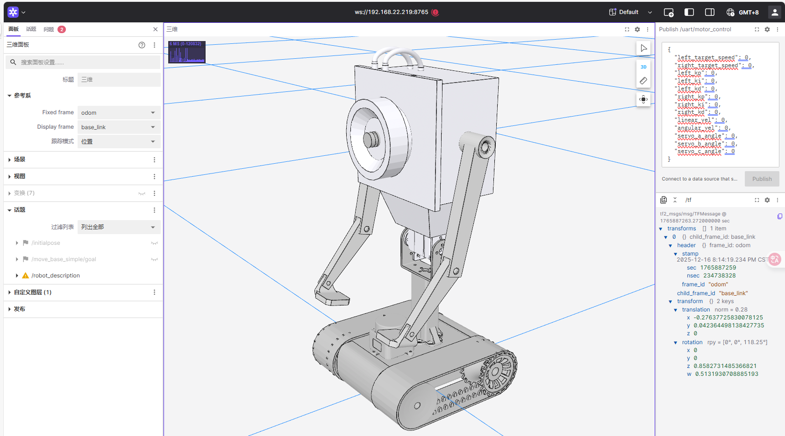

# Foxglove 可视化

先完成[端侧环境配置](device_setup.md)，让查看画面的电脑或平板与机器人处于同一局域网。本节连接 ROS 话题；摄像头网页画面按[视觉检测与推流](vision.md)配置。

## 端侧部署 (RK3588S)

Foxglove Bridge 用于将 ROS 2 话题通过 WebSocket 转发给 Foxglove Studio。

```bash
# 可选：安装 joint_state_publisher，用于无硬件数据的 URDF 调试
sudo apt-get install -y ros-humble-joint-state-publisher
# 配置 foxglove_bridge,实现话题转发
sudo apt-get install -y ros-humble-foxglove-bridge
# 配置 RTSP 转 WebRTC 网关，使用 go2rtc 拉取硬件编码 RTSP 流
```

机器人运行时，`/joint_states` 由 UART 节点发布。仅在脱离硬件调试 URDF 时使用 `joint_state_publisher`，不要让两个节点重复发布关节状态。

单独调试时启动桥接：

```bash
source /opt/ros/humble/setup.bash
ros2 run foxglove_bridge foxglove_bridge --ros-args -p port:=8765
```

`all_launch.launch.py` 也会启动该桥接；使用统一启动时不重复运行。RTSP 与 go2rtc 配置见[视觉检测与推流](vision.md)。

## 上位机连接 (PC/iPad)

1. 打开 [Foxglove Studio](https://foxglove.dev/) (网页版或客户端)。
2. 点击 **"Open Connection"**。
3. 选择 **"Foxglove WebSocket"** 协议。
4. 输入端侧地址：`ws://192.168.22.219:8765` (IP 根据实际情况调整)。
5. 连接成功后即可订阅和查看端侧的所有话题。

[](../_static/recovered/ylDPg0.png)

## 完成后检查

- 连接状态正常，话题列表中能看到已经启动的 ROS 节点所发布的话题。
- 底盘与 URDF 节点运行时，能看到 `/joint_states` 和 TF；启动雷达或 SLAM 后，再查看 `/scan` 和 `/map`。
- 只保留一个 Foxglove Bridge 实例，避免端口 `8765` 被重复占用。

接着按[视觉检测与视频推流](vision.md)配置摄像头画面，或按[SLAM 建图与定位](slam.md)查看雷达与地图。
