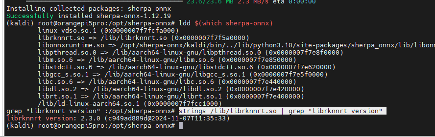
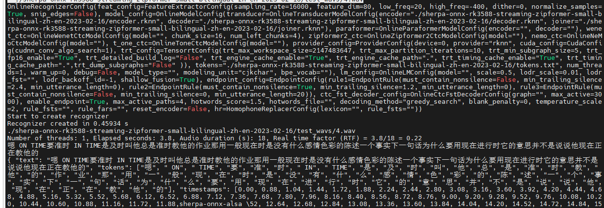
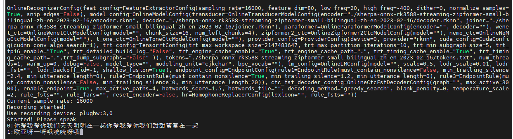
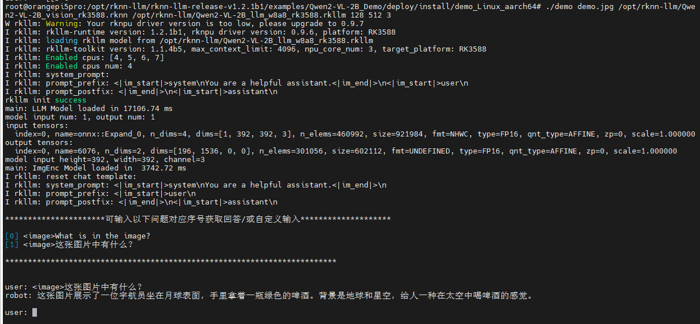
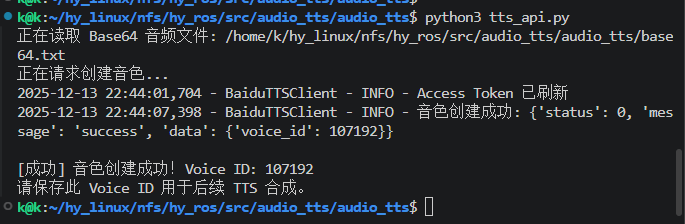

# 语音识别与合成

先完成[端侧环境](device_setup.md)和[麦克风测试](hardware_testing.md)。下面的安装命令在板卡的 root SSH 终端执行；模型和安装包按[资料获取](../7_Resources.md)下载到 `/mnt/nfs/hy_ros/source/`。依次完成识别、文本生成和音色配置后，再启动 ROS 语音节点。

## 部署 Sherpa-ONNX-RKNPU 流式 ASR 模型

**参考：**[Sherpa-ONNX for RKNPU](https://k2-fsa.github.io/sherpa/onnx/rknn/install.html#)

### 安装 Sherpa-ONNX-RKNPU

```shell
# 1. ROS2功能包API调用库
sudo apt-get install libportaudio2  # 安装 PortAudio 库
pip3 install sounddevice # 安装 Python 音频处理库

# 2.安装sherpa-onnx，
mkdir /opt/sherpa-onnx
cd /opt/sherpa-onnx

# 1> 方式1：在线下载安装
pip install sherpa-onnx -f https://k2-fsa.github.io/sherpa/onnx/rk-npu-cn.html

# 2> 方式2：直接复制文件到/opt/sherpa-onnx/目录下
cp /mnt/nfs/hy_ros/source/0.RK3588S/1.sherpa-onnx/sherpa-onnx-cp310/sherpa_onnx-1.12.19-cp310-cp310-manylinux_2_27_aarch64.whl /opt/sherpa-onnx/
chmod +x /opt/sherpa-onnx/sherpa_onnx-1.12.19-cp310-cp310-manylinux_2_27_aarch64.whl
# 安装sherpa-onnx
pip3 install sherpa_onnx-1.12.19-cp310-cp310-manylinux_2_27_aarch64.whl
which sherpa-onnx

# 3.复制librknnrt.so文件到/opt/sherpa-onnx/目录下
cp /mnt/nfs/hy_ros/source/0.RK3588S/1.sherpa-onnx/sherpa-onnx-rknn-stream/librknnrt.so /opt/sherpa-onnx/
chmod +x /opt/sherpa-onnx/librknnrt.so

# 更新/lib/librknnrt.so 或 /usr/lib/librknnrt.so
cp /opt/sherpa-onnx/librknnrt.so /lib/
cp /opt/sherpa-onnx/librknnrt.so /usr/lib/

# 4. 系统级修复libonnxruntime.so库动态链接问题，为后续ros2 C++开发提供支持
echo "$(python3 -c "import sherpa_onnx, os; print(os.path.join(os.path.dirname(sherpa_onnx.__file__), 'lib'))")" | sudo tee /etc/ld.so.conf.d/sherpa_onnx.conf
sudo ldconfig

# 5. 检查是否开启rknn支持，具体检查是否具有librknnrt.so库，若没有则参考连接手动安装
ldd $(which sherpa-onnx)
# 查看已安装的 rknnrt 版本
strings /lib/librknnrt.so | grep "librknnrt version"
```

[](../_static/recovered/ylDRYF.png)

### 下载预训练模型并终端测试

使用[资料获取](../7_Resources.md)提供的模型与配套运行库，先完成下面的音频文件解码和麦克风测试。若 ASR 在 `librknnrt` 2.3.x / 2.4.x 下崩溃，按 [Sherpa 模型说明](https://k2-fsa.github.io/sherpa/onnx/rknn/models.html)为 ASR 进程单独配置 2.2.0 运行库；不要直接替换整机运行库，以免影响视觉推理。

**参考：**[pre-trained models for RKNPU](https://k2-fsa.github.io/sherpa/onnx/rknn/models.html#)

```shell
# 1> 方式1：在线下载文件
wget https://github.com/k2-fsa/sherpa-onnx/releases/download/asr-models/sherpa-onnx-rk3588-streaming-zipformer-small-bilingual-zh-en-2023-02-16.tar.bz2

# 2> 方式2：直接复制文件到/opt/sherpa-onnx/目录下
cp /mnt/nfs/hy_ros/source/0.RK3588S/1.sherpa-onnx/sherpa-onnx-rknn-stream/sherpa-onnx-rk3588-streaming-zipformer-small-bilingual-zh-en-2023-02-16.tar.bz2 /opt/sherpa-onnx/

# 2. 解压文件
tar xvf sherpa-onnx-rk3588-streaming-zipformer-small-bilingual-zh-en-2023-02-16.tar.bz2
rm sherpa-onnx-rk3588-streaming-zipformer-small-bilingual-zh-en-2023-02-16.tar.bz2

# 3. 可监控rknpu加载状态
watch -n 0.5 cat /sys/kernel/debug/rknpu/load

# 4. 解码文件,查看是否正常工作
sherpa-onnx \
  --provider=rknn \
  --encoder=./sherpa-onnx-rk3588-streaming-zipformer-small-bilingual-zh-en-2023-02-16/encoder.rknn \
  --decoder=./sherpa-onnx-rk3588-streaming-zipformer-small-bilingual-zh-en-2023-02-16/decoder.rknn \
  --joiner=./sherpa-onnx-rk3588-streaming-zipformer-small-bilingual-zh-en-2023-02-16/joiner.rknn \
  --tokens=./sherpa-onnx-rk3588-streaming-zipformer-small-bilingual-zh-en-2023-02-16/tokens.txt \
  ./sherpa-onnx-rk3588-streaming-zipformer-small-bilingual-zh-en-2023-02-16/test_wavs/4.wav

# 5. 实时音频测试
sherpa-onnx-alsa \
  --provider=rknn \
  --encoder=./sherpa-onnx-rk3588-streaming-zipformer-small-bilingual-zh-en-2023-02-16/encoder.rknn \
  --decoder=./sherpa-onnx-rk3588-streaming-zipformer-small-bilingual-zh-en-2023-02-16/decoder.rknn \
  --joiner=./sherpa-onnx-rk3588-streaming-zipformer-small-bilingual-zh-en-2023-02-16/joiner.rknn \
  --tokens=./sherpa-onnx-rk3588-streaming-zipformer-small-bilingual-zh-en-2023-02-16/tokens.txt \
  plughw:3,0
```

[](../_static/recovered/ylDg1m.png)

[](../_static/recovered/ylDqT9.png)

离线测试应输出音频中的文字；实时测试应能识别对麦克风说出的话。`plughw:3,0` 是示例设备号，按麦克风测试结果修改，完成后按 `Ctrl+C` 停止测试程序。

## 部署 RKLLM Qwen3-VL-2B 模型

先使用 SDK 的独立示例检查模型是否能加载。该示例可使用图像输入；后面启动的 `audio_rkllm` ROS 节点只提供文本推理，拍照触发后的图片不会参与推理，视觉编码器接入仍需后续开发。

**参考：**

- [RKLLM 模型转换](https://doc.embedfire.com/linux/rk356x/Ai/zh/latest/lubancat_ai/example/qwen2_vl.html)
- [Qwen-VL-2B 部署 RK3588S](https://blog.csdn.net/lajuchenghui/article/details/150111489)

```shell
# 1. 安装 SDK 图像示例与 ROS 拍照功能所需的 OpenCV 库
sudo apt-get install libopencv-dev python3-opencv # 安装 OpenCV 库

# 2.新建目录
mkdir /opt/rknn-llm
cd /opt/rknn-llm
# 使用与模型配套的 RKLLM SDK 1.2.3
git clone --branch release-v1.2.3 --depth 1 https://github.com/airockchip/rknn-llm.git
cd rknn-llm
git checkout f7df8e5de9b40dc7aaa66194cf14d4895aaf159a
# 使用配套的 aarch64 编译脚本
cp /mnt/nfs/hy_ros/resources/rkllm/build-linux.sh examples/multimodal_model_demo/deploy/build-linux.sh
sudo apt install -y cmake gcc-aarch64-linux-gnu g++-aarch64-linux-gnu

# 3.进入multimodal_model_demo/deploy目录
cd /opt/rknn-llm/rknn-llm/examples/multimodal_model_demo/deploy
chmod +x build-linux.sh
./build-linux.sh

# 4.更新librkllmrt.so库，为后续ros2 C++开发提供支持
cp /opt/rknn-llm/rknn-llm/rkllm-runtime/Linux/librkllm_api/aarch64/librkllmrt.so /lib/
chmod +x /lib/librkllmrt.so

# 5. 更新rkllm.h头文件，为后续ros2 C++开发提供支持
cp /opt/rknn-llm/rknn-llm/rkllm-runtime/Linux/librkllm_api/include/rkllm.h /usr/include/
cp /opt/rknn-llm/rknn-llm/examples/multimodal_model_demo/deploy/3rdparty/librknnrt/Linux/librknn_api/include/rknn_api.h /usr/include/
sudo ldconfig
ls -l /usr/include/rkllm.h
ls -l /usr/include/rknn_api.h

# 6.复制rkllm模型文件
cd install/demo_Linux_aarch64

# 复制模型文件到示例目录
cp /mnt/nfs/hy_ros/source/0.RK3588S/2.rknn-llm/qwen3-vl-2b_vision_rk3588.rknn /opt/rknn-llm/
cp /mnt/nfs/hy_ros/source/0.RK3588S/2.rknn-llm/qwen3-vl-2b-instruct_w8a8_rk3588.rkllm /opt/rknn-llm/
chmod +x /opt/rknn-llm/qwen*

# 7.设置环境变量
export LD_LIBRARY_PATH=./lib

# 8. 运行示例
./demo demo.jpg /opt/rknn-llm/qwen3-vl-2b_vision_rk3588.rknn /opt/rknn-llm/qwen3-vl-2b-instruct_w8a8_rk3588.rkllm 2048 4096 3
```

[](../_static/recovered/ylD5Qc.png)

[](../_static/recovered/ylDef6.png)

示例应能加载模型并输出回答；如果出现库或模型加载错误，先检查模型路径、SDK 版本和 `LD_LIBRARY_PATH`，再继续 ROS 部署。

## 部署百度大模型音色复刻 TTS

**参考：**[百度大模型音色复刻 TTS](https://cloud.baidu.com/doc/SPEECH/s/Am8wytft2)

1. 安装必要的 python 库

   ```{note}
   主机侧和端侧均需要安装，音色管理创建等操作可以在主机侧进行。
   ```

   ```shell
   # 安装异步 http 库和 websockets 库
   sudo apt-get install python3-aiohttp python3-websockets
   ```

2. 复刻本人音色，需录制 15s 任意文本音频，并转换为 base64 编码的 mp3 格式

   - [在线转换工具](https://www.toolfk.com/en/tools/audio-to-base64.html)
   - 准备自己的 Base64 音频文件，通过 `BAIDU_VOICE_SAMPLE` 指定绝对路径；未设置时测试脚本默认读取 `base64_robot.txt`

3. 机器人音色示例位于 `hy_ros/src/audio_tts/audio_tts/base64_robot.txt`，也可自行准备录音。

   ```{tip}
   通过 `BAIDU_VOICE_SAMPLE` 环境变量指定 base64 文件的完整路径。
   ```

4. 获取 API key

   - 参考[百度大模型应用创建](https://ai.baidu.com/ai-doc/REFERENCE/Bkru0l60m)创建应用配置百度智能云 api 密钥，Server Key
   - 在运行终端设置自己账号的 `BAIDU_API_KEY`、`BAIDU_SECRET_KEY` 环境变量，启动文件与测试程序会从环境读取。
   - 设置 `tts_api.py` 文件中的 `run_create_voice` 变量为 True，表示在运行时创建 Voice ID

5. 创建 Voice ID

   ```{note}
   可直接在主机侧运行创建并更新 Voice ID。
   ```

   - 在 `hy_ros/src/audio_tts/audio_tts` 目录下运行 `python3 tts_api.py`
   - 查看并记录返回的 Voice ID
   - 设置 `BAIDU_VOICE_ID` 环境变量为自己账号创建的音色 ID；每个启动 TTS 的终端都需加载这三个环境变量。

6. 音色管理

   - 设置 `tts_api.py` 文件中的 `run_tts` 变量为 True，表示在运行时使用音色复刻 TTS 进行测试
   - 设置 `tts_api.py` 文件中的 `run_list_voice` 变量为 True，表示在运行时查看 Voice ID 列表
   - 设置 `tts_api.py` 文件中的 `run_query_detail` 变量为 True，表示在运行时查看 Voice ID 详情
   - 设置 `tts_api.py` 文件中的 `run_delete_voice` 变量为 True，表示在运行时删除 Voice ID

[](../_static/recovered/ylD9td.png)

[](../_static/recovered/ylDMyg.png)

## 启动 ROS 语音链路

1. 在板卡编译语音功能包：

   ```bash
   cd /mnt/nfs/hy_ros
   source /opt/ros/humble/setup.bash
   colcon build --packages-up-to audio_asr audio_rkllm audio_tts
   source install/setup.bash
   ```

2. 打开三个独立终端，每个终端先加载 ROS 和工作区环境，再分别运行以下命令。TTS 所在终端还要设置前面获取的 `BAIDU_API_KEY`、`BAIDU_SECRET_KEY` 和 `BAIDU_VOICE_ID`。

   ```bash
   ros2 launch audio_asr audio_asr.launch.py
   ros2 launch audio_rkllm audio_rkllm.launch.py
   ros2 launch audio_tts audio_tts.launch.py
   ```

3. 检查 ASR 启动文件中的 `target_device_idx` 是否对应实际输入设备。ASR 使用 Python 音频设备索引，默认值为 `3`；它与 ALSA 的 `plughw:3,0` 是两种设备表示方式，按实际设备列表选择。

4. 启动底盘 UART 节点后，通过机器人的对话触发开关开始识别。UART 发布的 `/uart/chat_gpt_count` 增加时，ASR 开始录音。ASR 文本经 `/audio/asr_text` 送入 RKLLM，生成的回答通过 `/audio/llm_result` 送入 TTS。TTS 在 `http://<板卡IP>:8090/audio` 提供音频流，由播放端接收。

`all_launch` 不会启动这三个语音节点。该链路用于语音对话，没有将回答转换为底盘运动指令。

## 完成后检查

- 对麦克风说话后，`ros2 topic echo /audio/asr_text` 能显示识别文本。
- `ros2 topic echo /audio/llm_result` 能看到逐段生成的回答与结束标记。
- TTS 日志没有鉴权或音色错误，机器人播放端连接音频流后能听到回答。

语音配置完成后，可继续[Foxglove 可视化](visualization.md)或[视觉检测与推流](vision.md)。
